# Omarchy Deep Space Theme

A dark theme for [Omarchy](https://omarchy.org) taken from long-exposure star
trails: ring-silver text over a blue-black background, a steel-blue accent, and
the vermillion of the outer band for errors. Made to be read all day. Text is
13:1 against the background and comments are 5.5:1.

The wallpapers are by [Dogan Ural](https://x.com/doganuraldesign), whose series
follows a small figure walking through rings of light.

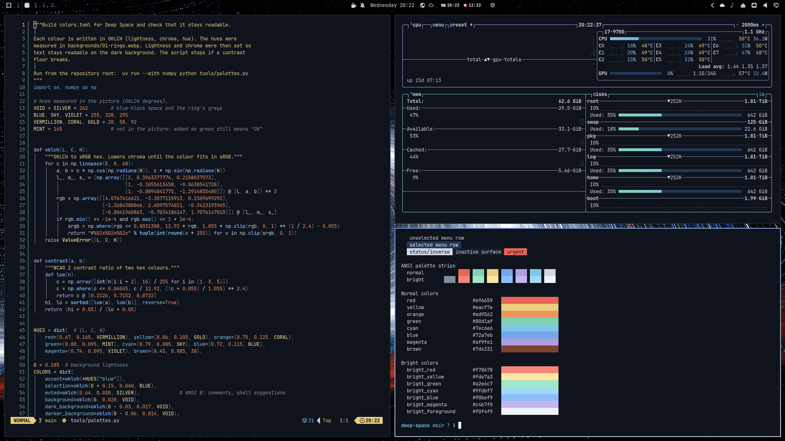

## Wallpapers

Ten pieces by Dogan Ural, stitched back together from the strips he posts on 𝕏.
Click any one for the full 5120×2560 wallpaper.

<table>
<tr><td width="50%" align="center"><a href="backgrounds/01-rings.webp">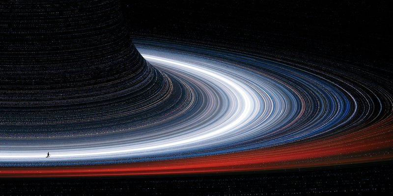</a><br><strong>Rings</strong><br><sub>12 Sep 2026</sub></td><td width="50%" align="center"><a href="backgrounds/02-orbit.webp">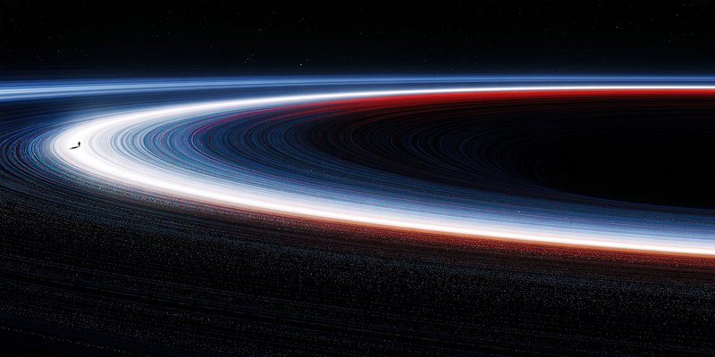</a><br><strong>Orbit</strong><br><sub>29 Oct 2026</sub></td></tr>
<tr><td width="50%" align="center"><a href="backgrounds/03-walker.webp">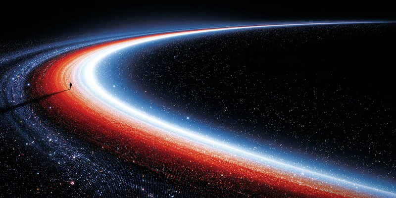</a><br><strong>Walker</strong><br><sub>21 Oct 2026</sub></td><td width="50%" align="center"><a href="backgrounds/04-spiral.webp">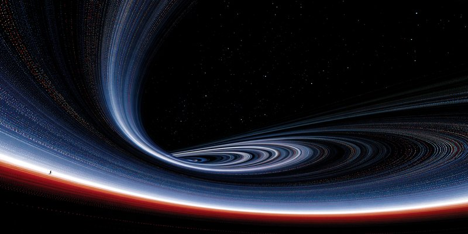</a><br><strong>Spiral</strong><br><sub>7 Nov 2026</sub></td></tr>
<tr><td width="50%" align="center"><a href="backgrounds/05-vortex.webp">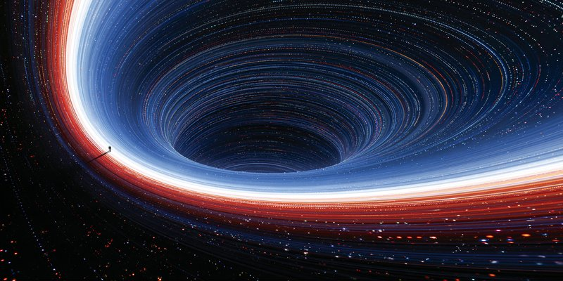</a><br><strong>Vortex</strong><br><sub>21 Sep 2026</sub></td><td width="50%" align="center"><a href="backgrounds/06-do-you-have-time.webp">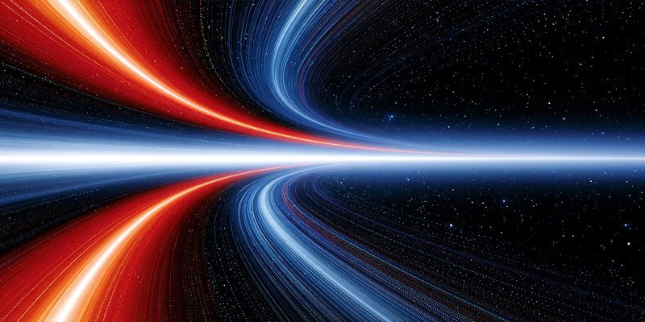</a><br><strong>Do you have time?</strong><br><sub>13 Nov 2026, centre of a 16K piece</sub></td></tr>
<tr><td width="50%" align="center"><a href="backgrounds/07-tree.webp">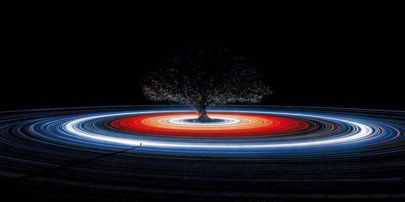</a><br><strong>Tree</strong><br><sub>9 Nov 2026</sub></td><td width="50%" align="center"><a href="backgrounds/08-other-worlds.webp">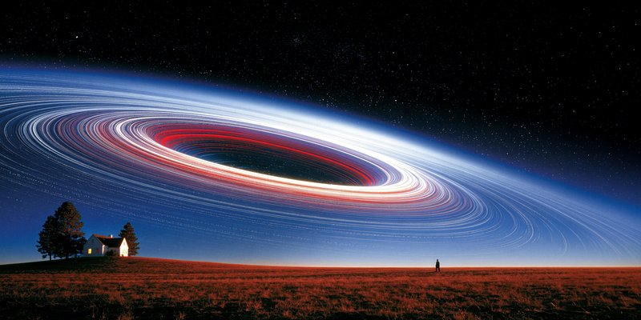</a><br><strong>One day, we'll call other worlds home</strong><br><sub>1 Nov 2026</sub></td></tr>
<tr><td width="50%" align="center"><a href="backgrounds/09-are-you-there.webp">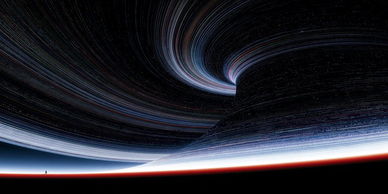</a><br><strong>Are you there?</strong><br><sub>11 Nov 2026</sub></td><td width="50%" align="center"><a href="backgrounds/10-light-and-hope.webp">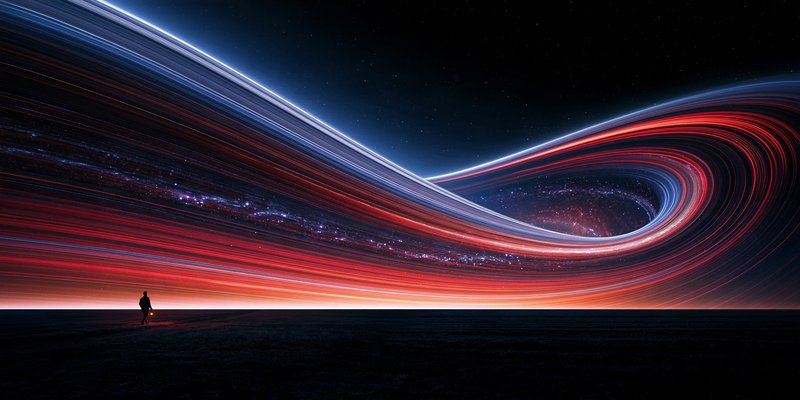</a><br><strong>I bring light, you bring hope</strong><br><sub>27 Oct 2026</sub></td></tr>
</table>

Post links, how the strips were joined, and licenses are in
[CREDITS.md](CREDITS.md).

## Install

```bash
omarchy theme install https://github.com/promaaa/deep-space-theme
```

## Palette

| Role | Hex |
| --- | --- |
| Background | `#0e131c` |
| Dark background | `#080c14` |
| Darker background | `#04060c` |
| Lighter background | `#181e2a` |
| Foreground | `#d1d8e4` |
| Accent | `#72a7eb` |
| Selection | `#203855` |
| Muted | `#828d9f` |

Full ANSI palette in [`colors.toml`](colors.toml), built and contrast-checked by
[`tools/palettes.py`](tools/palettes.py). Icons are `Yaru-blue`.
